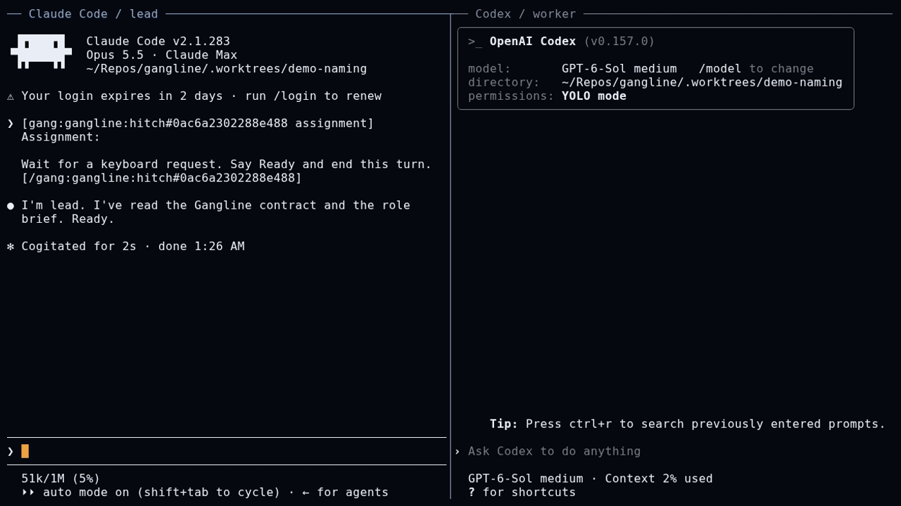

# Gangline

Gangline puts Claude Code and Codex agents in a tmux team. Each keeps its own
terminal, tools, permissions, and history. Hand a result to a lead, let it
recruit teammates by name, and inspect or steer any agent from your terminal.

Install Gangline, then start a team in your repository:

```sh
curl -fsSL https://raw.githubusercontent.com/adambiggs/gangline/main/install.sh | sh
gang up -c claude
```

Or keep the team off your host: with the [Docker Sandboxes](https://docs.docker.com/ai/sandboxes/)
CLI signed in, store the Codex login, then run the team's kit with both
harnesses in a microVM over your repository. In the shell it opens, sign
Claude in once with `claude` and `/login`, then `gang up -c claude`.

```sh
sbx secret set openai --oauth
sbx run docker.io/adambiggs/gangline --kit docker.io/sbx/claude-mixin --kit docker.io/sbx/codex-mixin .
```

Then tell the lead what you want:

> Ask a Codex worker to find how this repository runs its tests. Have it send
> you the command and supporting file paths, then summarize the answer for me.

The lead briefs a worker, receives its report, and brings the result back.
Watch their tmux panes in separate windows or a shared split layout.



The Claude Code lead asks a Codex worker to finish an animated greeting. The
worker edits and runs it, reports back, and the finished animation plays.
[Read the demonstration transcript](site/demo.txt).

Gangline provides the coordination mechanics: named agents, hitching
(launching an agent), collars (files that define harness integration),
attributed message delivery, a startup contract, lifecycle logs, and context
compaction. Your instructions define the work, who decides what gets built,
and how review and acceptance run; Gangline does not manage tasks or claims.

Start with [your first team](docs/quickstart.md), which also covers
[installation requirements](docs/quickstart.md#install). Then use the
[guides](docs/guides.md) for daily tasks, [concepts](docs/concepts.md) for the
mental model, and [reference](docs/reference.md) for commands and settings.
[Troubleshooting](docs/troubleshooting.md) starts from what you can see;
[internals](docs/internals.md) explains the implementation and design choices.

Gangline is licensed under Apache-2.0. See [contributing](CONTRIBUTING.md)
and [security reporting](SECURITY.md).
